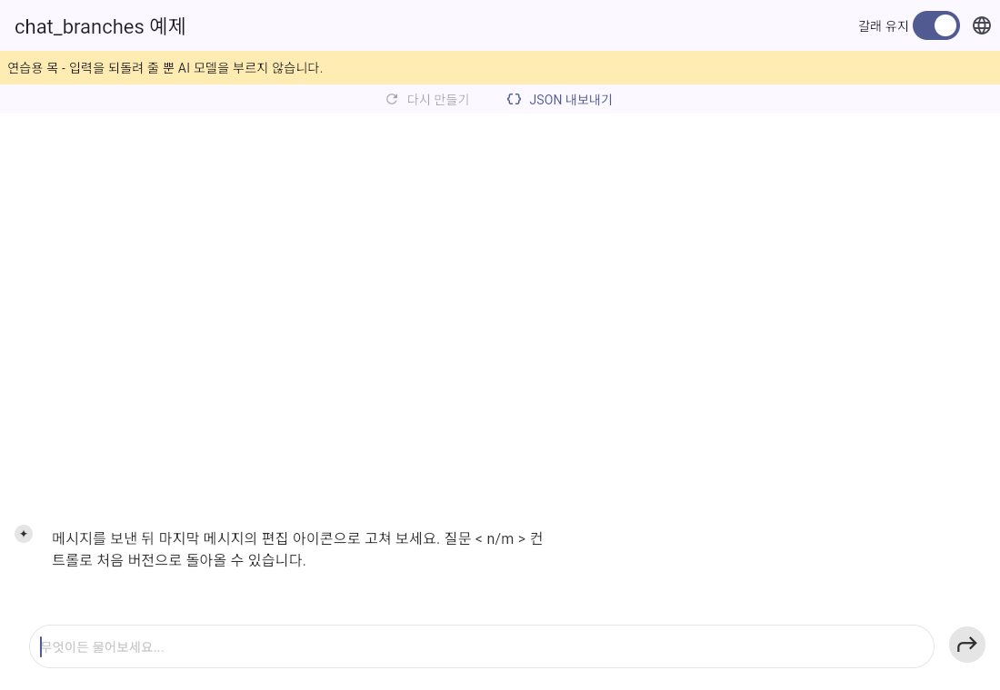
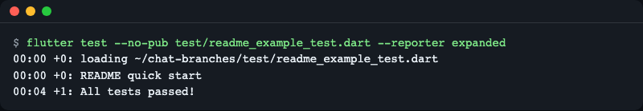
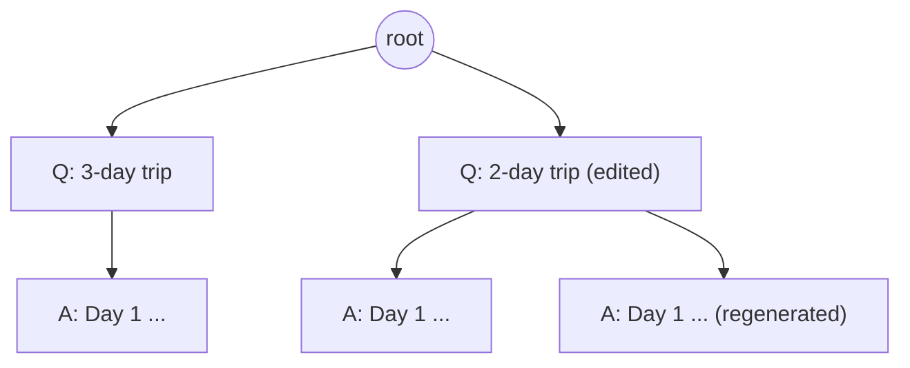
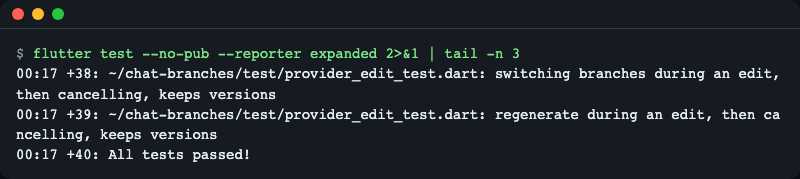

# chat_branches

[English](README.md) | **한국어**

Flutter AI Toolkit 채팅에서 고친 질문과 다시 만든 답변을 모두 갈래(`< 2/3 >`)로 남겨 서로 넘나들 수 있게 합니다. 이미 쓰는 `LlmProvider` 를 감싸기만 하면 질문을 고쳐도 이전 질문·답변 쌍이 사라지지 않고, 대화 트리 전체를 JSON 으로 저장·복원할 수 있습니다. Flutter 없이 쓰는 순수 Dart 대화 트리도 함께 들어 있습니다.



*예제 앱(한국어 화면). 브라우저에서 열고 메시지를 보낸 뒤 편집 아이콘으로 고치면, `질문 < n/m >` 막대로 두 버전을 넘겨 볼 수 있습니다. 같은 화면의 영어판은 [README.md](README.md) 에 있습니다.*

## 설치

```bash
flutter pub add chat_branches
```

pub.dev 에 올라가기 전에는 저장소를 바로 가리킵니다.

```yaml
dependencies:
  chat_branches:
    git:
      url: https://github.com/LeeGyeongPil/chat-branches
```

Flutter 3.29 이상(Dart 3.7 을 싣는 첫 버전)과 `flutter_ai_toolkit` 1.x 가 필요합니다. 실제로 시험한 버전: Flutter 3.32.4 + 툴킷 1.0.0(아래 override 필요), CI 는 최신 stable Flutter. Flutter 가 없다면 [설치 안내](https://docs.flutter.dev/get-started/install)를 보세요. 런타임 의존성은 Flutter 와 `flutter_ai_toolkit` 뿐입니다.

구 Flutter(예: 3.32)에서는 툴킷이 끌어오는 최신 `firebase_ai` 3.x 가 `live_session.dart` 의 `@internal` 오류로 컴파일되지 않을 수 있습니다. 최신 stable Flutter 를 쓰거나, 앱의 `pubspec.yaml` 에 이전 릴리스를 고정하세요.

```yaml
dependency_overrides:
  firebase_ai: 3.4.0
```

## 빠르게 시작하기

공급자를 감싸고, 보내고, 고치고, 되돌아가고, 저장합니다. 코드는 `test/readme_example_test.dart` 의 흐름을 그대로 따릅니다(테스트는 `print` 대신 `expect` 를 씁니다). `EchoProvider` 가 입력을 그대로 돌려주므로 API 키 없이 돌아갑니다.

```dart
import 'dart:convert';

import 'package:chat_branches/chat_branches.dart';
import 'package:flutter_ai_toolkit/flutter_ai_toolkit.dart';

Future<void> main() async {
  // 1. 이미 쓰는 공급자를 감쌉니다.
  final provider = BranchingProvider(EchoProvider());

  await provider.sendMessageStream('Plan a 3-day trip to Busan').drain<void>();

  // 2. 사용자가 마지막 질문을 고치면 채팅 화면이 이렇게 합니다:
  //    기록을 줄인 뒤 새 문장을 보냅니다.
  provider.history = provider.history.take(0);
  await provider.sendMessageStream('Plan a 2-day trip to Busan').drain<void>();

  // 3. 질문에 버전이 둘 생겼습니다. 첫 버전으로 돌아갑니다.
  final question = provider.history.first;
  final info = provider.branchInfoOf(question)!;
  print('${info.index + 1}/${info.count}'); // 2/2
  provider.selectSibling(question, 0);
  print(provider.history.first.text); // Plan a 3-day trip to Busan

  // 4. 저장하고 복원합니다.
  final saved = jsonEncode(provider.toJson());
  final restored = BranchingProvider(
    EchoProvider(),
    tree: BranchingProvider.treeFromJson(
      jsonDecode(saved) as Map<String, Object?>,
    ),
  );
  print(restored.history.first.text); // Plan a 3-day trip to Busan
}
```

`flutter_ai_toolkit` 이 Flutter(`dart:ui`)를 필요로 하므로 이 파일은 `dart run` 으로 돌릴 수 없습니다. Flutter 앱이나 `flutter test` 안에서 실행하세요. 저장소는 이 흐름을 테스트로 돌립니다.

```bash
flutter test test/readme_example_test.dart
```

```text
00:00 +0: README quick start
00:04 +1: All tests passed!
```



*통과한 빠른 시작 테스트.*

실제 앱에서는 `EchoProvider()` 자리에 쓰는 공급자를 넣고 감싼 객체를 채팅 화면에 넘깁니다: `LlmChatView(provider: BranchingProvider(yourProvider))`. 화면은 활성 경로만 보므로 다른 코드는 바꿀 필요가 없습니다.

## 핵심 개념

채팅은 목록이 아니라 트리입니다. 메시지 하나가 노드 하나입니다. 고친 질문은 이전 질문의 형제(sibling)가 되고, 다시 만든 답변은 이전 답변의 형제가 됩니다. 채팅 화면에 보이는 메시지는 뿌리에서 잎 하나까지의 길, 곧 활성 경로입니다.



*질문 버전이 둘(`1/2`, `2/2`)이고, 두 번째 질문에는 답변이 둘 있습니다. 버전을 바꾸면 그 갈래가 다시 보입니다.*

- **형제(sibling)**: 같은 메시지의 다른 버전. `positionOf` / `branchInfoOf` 가 `(index, count)` 로 위치를 알려 주고, `< 2/3 >` 가 이 값을 보여 줍니다.
- **활성 경로**: 지금 보이는 메시지들. 형제로 바꾸면 그 갈래에서 마지막으로 보던 잎까지 내려가므로 보던 자리로 돌아옵니다.
- **갈라지는 지점(fork point)**: 버전이 나뉘는 노드. 감싼 공급자에게는 이 지점까지의 기록만 보내므로 모델은 다른 갈래를 보지 못합니다.
- **순수 코어**: `package:chat_branches/tree.dart` 는 Flutter·툴킷을 import 하지 않습니다. 어떤 값 타입으로도 단독으로 쓸 수 있습니다.

툴킷과 맞물리는 방식: 사용자가 마지막 질문을 고치면 툴킷 화면이 `provider.history` 를 짧은 목록으로 바꾼 뒤 새 문장을 보냅니다. `BranchingProvider` 가 이를 알아채 이전 쌍을 트리에 남기고 새 쌍을 그 옆에 붙입니다. 편집을 취소하면 같은 메시지가 되돌아오는데, 이때는 아무것도 추가하지 않습니다.

`history` 세터가 화면이 넘긴 값을 읽는 규칙:

| 화면이 넘기는 값 | 뜻 | 결과 |
|---|---|---|
| 활성 경로의 진접두사 | 편집 시작 | 갈라지는 지점이 그 자리로 옮겨 감(`isEditing` 이 true) |
| 활성 경로 전체 | 편집 취소 | 갈라지는 지점 해제 |
| 모두 트리에 있는 메시지 | 화면이 아는 메시지를 되돌려 놓음 | 마지막 메시지의 경로가 활성이 됨, 버전은 잃지 않음 |
| 그 밖 | 트리가 처음 보는 기록 | 한 갈래로 이전 |

감싼 공급자(`inner`)는 자기 세션을 따로 가지므로 그 기록도 활성 경로에 맞춰 둡니다. `history` 를 지정할 때마다 채팅 세션을 다시 시작하는 `FirebaseProvider` 같은 공급자 때문입니다. 모델에는 활성 경로만 보내므로 트리가 커져도 토큰은 늘지 않습니다. 프롬프트 길이는 지금 보고 있는 갈래 길이만큼입니다.

## API

전부 `package:chat_branches/chat_branches.dart` 로, 트리만은 `package:chat_branches/tree.dart` 로 가져옵니다.

### BranchingProvider

`LlmProvider` 데코레이터(`ChangeNotifier` 기도 합니다).

| 이름 | 하는 일 | 주요 인자 | 반환 |
|---|---|---|---|
| `BranchingProvider(inner, {tree})` | `inner` 를 감쌉니다. 저장한 대화를 복원하려면 `tree` 를 넘깁니다. | `LlmProvider inner`, `ConversationTree<ChatMessage>? tree` | 공급자 |
| `history` (get/set) | 활성 경로(화면이 편집 중이면 갈라지는 지점까지). setter 가 툴킷의 편집·취소 흐름을 이해합니다. | `Iterable<ChatMessage>` | `Iterable<ChatMessage>` |
| `sendMessageStream(prompt, {attachments})` | 질문을 추가하고 답변을 스트리밍합니다. | `String prompt` | `Stream<String>` |
| `generateStream(prompt, {attachments})` | `inner` 로 한 번 생성합니다. 트리는 바뀌지 않습니다. | `String prompt` | `Stream<String>` |
| `regenerate([llmMessage])` | 같은 질문을 다시 물어 새 답변 형제를 만듭니다. 기본은 마지막 답변. | `ChatMessage? llmMessage` | `Stream<String>` |
| `editAt(userMessage, text, {attachments})` | 어느 깊이의 질문이든 새 형제로 바꿉니다. 이전 버전과 그 아래는 그대로 남습니다. | `ChatMessage userMessage`, `String text` | `Stream<String>` |
| `selectSibling(message, index)` | `message` 의 `index` 번째(0부터) 버전을 보여 줍니다. | `ChatMessage message`, `int index` | `void` |
| `branchInfoOf(message)` | 형제 중 위치. 트리에 없으면 `null`. | `ChatMessage message` | `({int index, int count})?` |
| `nodeIdOf(message)` | `message` 를 가진 트리 노드의 id(동일 객체 비교). | `ChatMessage message` | `String?` |
| `reset()` | 대화를 비웁니다. | 없음 | `void` |
| `toJson()` | 트리 전체를 JSON 으로 만들 수 있는 데이터로. | 없음 | `Map<String, Object?>` |
| `BranchingProvider.treeFromJson(json)` | 저장한 트리를 읽습니다. | `Map<String, Object?> json` | `ConversationTree<ChatMessage>` |
| `tree`, `inner`, `isStreaming` | 트리, 감싼 공급자, 답변 스트리밍 중 여부. | | |
| `isEditing` | 툴킷 화면이 질문을 편집하는 동안 true(기록이 갈라지는 지점에서 잘려 있음). 그동안 전환·다시 만들기를 끄세요. | | `bool` |
| `dispose()` | 알림을 멈춥니다. `inner` 는 정리하지 않습니다. | 없음 | `void` |

`sendMessageStream`, `regenerate`, `editAt` 가 돌려주는 스트림은 반드시 구독해야 합니다(툴킷 화면은 그렇게 합니다). 바쁨 상태는 스트림이 끝날 때까지 유지됩니다.

### ConversationTree&lt;T&gt; (순수 Dart)

| 이름 | 하는 일 | 주요 인자 | 반환 |
|---|---|---|---|
| `ConversationTree({newId})` | 뿌리 노드만 있는 빈 트리. | 선택: id 생성기 | 트리 |
| `ConversationTree.fromLinear(values)` | `values` 를 순서대로 담은 한 갈래. | `Iterable<T>` | 트리 |
| `ConversationTree.fromJson(json, {decode})` | JSON v1 을 읽습니다. | `Map<String, Object?>`, `decode` | 트리 |
| `toJson({encode})` | JSON v1 을 씁니다(`format: "chat_branches"`, `version: 1`). | `encode` | `Map<String, Object?>` |
| `append(parentId, value)` | 자식 노드를 추가하고 활성 자식으로 만듭니다. | `String parentId`, `T value` | `TreeNode<T>` |
| `siblingsOf(id)`, `positionOf(id)` | 형제들, 그리고 `(index, count)`. | `String id` | 목록, 레코드 |
| `selectSibling(id, index)` | 형제를 활성화합니다(그 아래 마지막 잎까지). | `String id`, `int index` | `void` |
| `select(id)` | `id` 까지의 길을 활성 경로로 만듭니다. | `String id` | `void` |
| `activePath`, `activeValues`, `pathTo(id)` | 활성 경로의 노드·값, 노드까지의 길. | | 목록 |
| `rootId`, `length`, `nodes` | 뿌리 id, 메시지 수(뿌리 제외), 모든 노드. | | |

`TreeNode<T>` 는 `id`, `parentId`, `value` 를 제공합니다.

JSON v1(`toJson` 이 쓰는 형식, 사용 예 1 에 출력이 있습니다):

| 필드 | 뜻 |
|---|---|
| `format` | 항상 `"chat_branches"` |
| `version` | `1`, 다른 버전은 거부합니다 |
| `root` | 뿌리 노드의 id |
| `nodes` | 노드 목록. 각 노드는 `id`, `parent`(뿌리는 `null`), `children`(순서 있는 id), `active`(활성 자식의 위치), `value`(인코딩된 메시지, 뿌리는 없음) |

### 위젯과 예외

| 이름 | 하는 일 | 주요 인자 | 반환 |
|---|---|---|---|
| `BranchSwitcher` | `< 2/3 >` 컨트롤. 양 끝과 `enabled` 가 false 일 때 버튼이 비활성입니다. | `index`(0부터), `count`, `onSelect`, `enabled`, `labels` | 위젯 |
| `BranchSwitcherLabels` | 툴팁과 위치 글자. `BranchSwitcherLabels.en`(기본)과 `.ko` 가 들어 있고, 다른 언어는 직접 만듭니다. | | 라벨 |
| `BranchBusyException` | 답변 스트리밍 중에 전환·편집·재생성하면 던집니다. | | 예외 |
| `NodeNotFoundException` | 없는 노드 id 일 때 던집니다. | | 예외 |
| `TreeFormatException` | `fromJson` 이 던집니다. 메시지에 잘못된 필드 이름이 들어 있습니다(형식·버전 2·깨진 참조·범위 밖 active). | | 예외 |

## 사용 예

### 1. Flutter 없이 트리만 쓰기

```dart
import 'dart:convert';

import 'package:chat_branches/tree.dart';

void main() {
  final tree = ConversationTree<String>();
  final q1 = tree.append(tree.rootId, 'Plan a 3-day trip');
  tree.append(q1.id, 'Day 1: ...');
  final q2 = tree.append(tree.rootId, 'Plan a 2-day trip'); // q1 의 형제

  print(tree.positionOf(q2.id)); // (count: 2, index: 1)
  print(tree.activeValues); // [Plan a 2-day trip]

  tree.selectSibling(q2.id, 0);
  print(tree.activeValues); // [Plan a 3-day trip, Day 1: ...]

  final json = tree.toJson(encode: (v) => v);
  print(jsonEncode(json));
  final back = ConversationTree<String>.fromJson(
    json,
    decode: (j) => j! as String,
  );
  print(back.activeValues); // [Plan a 3-day trip, Day 1: ...]
}
```

출력(패키지 테스트 환경에서 이 코드를 실제로 돌려 기록한 값):

```text
(count: 2, index: 1)
[Plan a 2-day trip]
[Plan a 3-day trip, Day 1: ...]
{"format":"chat_branches","version":1,"root":"n0","nodes":[{"id":"n0","parent":null,"children":["n1","n3"],"active":0},{"id":"n1","parent":"n0","children":["n2"],"active":0,"value":"Plan a 3-day trip"},{"id":"n2","parent":"n1","children":[],"active":0,"value":"Day 1: ..."},{"id":"n3","parent":"n0","children":[],"active":0,"value":"Plan a 2-day trip"}]}
[Plan a 3-day trip, Day 1: ...]
```

### 2. 채팅 화면과 전환 컨트롤 함께 쓰기

```dart
final provider = BranchingProvider(EchoProvider()); // 또는 쓰는 공급자

// 채팅 화면: 마지막 질문의 편집 아이콘이 전과 똑같이 동작합니다.
LlmChatView(provider: provider);

// 가진 메시지(예: 첫 질문)용 전환 컨트롤:
ListenableBuilder(
  listenable: provider,
  builder: (context, _) {
    final question = provider.history.first;
    final info = provider.branchInfoOf(question)!;
    return BranchSwitcher(
      index: info.index,
      count: info.count,
      enabled: !provider.isStreaming,
      onSelect: (i) => provider.selectSibling(question, i),
    );
  },
);
```

`example/` 앱이 질문·답변 막대와 **다시 만들기** 버튼, **JSON 내보내기** 로 같은 연결을 합니다. 이 조각은 그 연결의 스케치이고, 실행되는 버전은 `example/lib/branch_bar.dart` 입니다.

### 3. 중간 질문 고치기

`LlmChatView` 는 마지막 질문에만 편집 동작을 보여 줍니다. 앞쪽 질문은 가진 메시지로 `editAt` 을 부르면 되고, 이전 버전과 그 아래는 그대로 남습니다.

```dart
final first = provider.history.first;
await provider.editAt(first, 'A 2-day plan instead').drain<void>();
```

동작은 `test/provider_regenerate_test.dart` 가 확인합니다(세 번 오간 대화의 첫 질문을 고치고, 이전 여섯 메시지 갈래를 `selectSibling` 으로 복원).

### 4. 예제 앱 실행

```bash
cd example
flutter run -d web-server --web-port 8080
```

`http://localhost:8080/` 을 엽니다(`flutter run` 이 출력하는 주소입니다. 개발 서버가 `localhost` 에서만 대기할 수 있어 `127.0.0.1` 은 거부될 수 있습니다). 주소 끝에 `?lang=ko` 를 붙이면 한국어입니다. 앱 막대의 언어 메뉴로도 바꿀 수 있고 선택이 저장되며, 처음 실행은 기기 언어를 따릅니다(한국어가 아니면 영어). 앱 자체 문구와 툴킷에서 바꿀 수 있는 문구(입력창 안내 등)는 번역되지만, `flutter_ai_toolkit` 1.0.0 은 편집 중 표시 "Editing" 과 말풍선 메뉴(Edit, Copy)를 영어로만 그리므로 한국어 화면에서도 이 셋은 영어로 남습니다. "갈래 유지" 스위치를 끄면 툴킷 단독 동작, 곧 이전 쌍이 대체되는 모습을 볼 수 있습니다.

예제는 `EchoProvider` 기반의 **연습용 목(mock)** 을 씁니다. 입력에 `Take #n` 을 붙여 되돌려 줄 뿐 AI 모델을 부르지 않습니다. 실제 공급자에서는 답변이 모델에서 오며 느린 모델이면 재생성이 오래 걸릴 수 있지만 갈래 동작은 같습니다.

## 언제 쓰나

- 이럴 때: 이미 `LlmChatView`(또는 임의의 `LlmProvider`)로 채팅을 보여 주고 있고, 사용자가 버전을 남겨 넘겨 보게 하거나 대화 트리를 저장하고 싶을 때.
- 이럴 때: 버전이 붙은 JSON 형식을 가진 작은 대화 트리가 순수 Dart 로 필요할 때.
- 다른 선택: 자체 공급자 계층을 가진 완성형 채팅 클라이언트를 원하면 [flutter_ai_client](https://pub.dev/packages/flutter_ai_client), 갈래 없는 평평한 기록으로 충분하면 [flutter_ai_toolkit](https://pub.dev/packages/flutter_ai_toolkit) 만으로 됩니다.
- 한계: 툴킷 화면은 마지막 질문에만 편집 동작을 보여 주며, 툴킷 화면 안의 말풍선마다 `< n/m >` 를 다는 것은 응답 빌더로는 불가능합니다. `BranchSwitcher` 를 화면 옆이나 둘레에 두세요.
- 한계: `LlmChatView` 에 `messageSender` 를 지정하면 공급자를 거치지 않으므로 그 메시지는 트리에 남지 않습니다. 화면이 공급자의 `sendMessageStream` 을 부르게 두세요.

## 버전·호환성

- [유의적 버전](https://semver.org/lang/ko/)을 따릅니다. 0.x 동안은 마이너 버전에서 API 가 바뀔 수 있고, 바뀌면 [CHANGELOG.md](CHANGELOG.md) 에 적습니다.
- Flutter 3.32.4 의 `flutter_ai_toolkit` 1.0.0 에서 테스트했고, 설치 절의 `firebase_ai: 3.4.0` override 가 필요했습니다. 선언한 하한은 Flutter 3.29(Dart 3.7 을 싣는 첫 버전)이며, 3.29 자체는 시험하지 않았습니다. CI 는 최신 stable Flutter 와 툴킷 1.2.x 줄도 돌립니다.
- 편집·취소 처리는 툴킷 채팅 화면이 `history` 를 쓰는 방식에 기댑니다. 툴킷 1.0.0~1.2.0 에서 성립함을 소스로 확인했습니다.

## 문제 해결

- **`BranchBusyException`**: 답변이 스트리밍되는 중에 전환·편집·재생성했습니다. 스트림이 끝나길 기다리거나 `isStreaming` 이 true 인 동안 컨트롤을 비활성화하세요.
- **직접 부른 뒤 계속 "스트리밍 중"으로 보임**: `sendMessageStream`, `regenerate`, `editAt` 이 돌려준 스트림을 구독하지 않았습니다. 구독하세요(`await stream.drain<void>()`).
- **`TreeFormatException: version ...`**: 다른 형식이나 버전의 JSON 입니다. 이 릴리스는 `chat_branches` 버전 1 만 읽습니다.
- **프록시 뒤나 오프라인에서 `flutter pub get` 실패**: 이 패키지가 아니라 패키지 관리자가 pub.dev 에 닿지 못한 것입니다. 닿을 수 있는 미러를 `PUB_HOSTED_URL` 로 지정하세요.

## 개발

```bash
flutter analyze
flutter test
cd example && flutter test
```

```text
No issues found!
All tests passed!   # 패키지 테스트 40개
All tests passed!   # example/ 테스트 7개
```



*모두 통과한 패키지 테스트.*

## 더 알아보기

- [flutter/ai 이슈 85](https://github.com/flutter/ai/issues/85): 툴킷에 갈래 있는 채팅 기록을 요청한 글.
- [Flutter AI Toolkit](https://docs.flutter.dev/ai/ai-toolkit): `LlmChatView`·`LlmProvider` 공식 문서.
- [툴킷 채팅 화면 소스](https://github.com/flutter/ai/tree/main/lib/src): 편집·취소가 `history` 를 부르는 방식.

## 라이선스

MIT.
