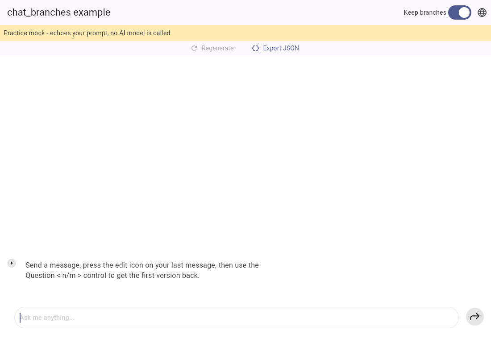
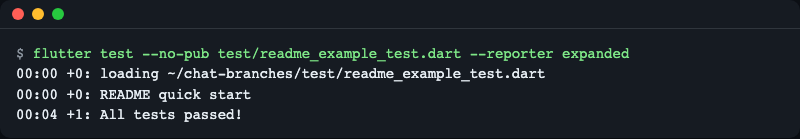
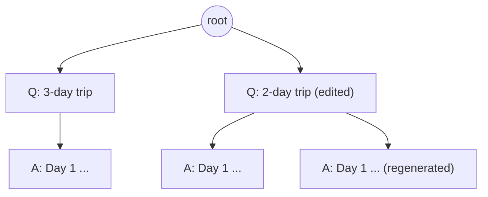
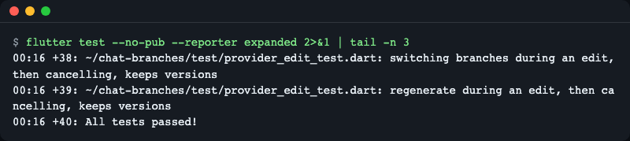

# chat_branches

**English** | [한국어](README.ko.md)

Keep every edited question and regenerated answer as a switchable branch (`< 2/3 >`) in Flutter AI Toolkit chats. `chat_branches` wraps the `LlmProvider` you already use, so editing a question no longer throws the old question and answer away, and the whole conversation tree can be saved and restored as JSON. It also ships a conversation tree that imports no Flutter code (installing the package still needs the Flutter SDK).



*The example app (English). Open it in a browser, send a message, press the edit icon on it, and flip between the two versions with the `Question < n/m >` bar. The same screen in Korean is in [README.ko.md](README.ko.md).*

## Install

```bash
flutter pub add chat_branches
```

Until the package is on pub.dev, use the repository directly:

```yaml
dependencies:
  chat_branches:
    git:
      url: https://github.com/LeeGyeongPil/chat-branches
```

Requires Flutter 3.29 or newer (the first release that ships Dart 3.7), and `flutter_ai_toolkit` 1.x. Versions actually tested: Flutter 3.32.4 with toolkit 1.0.0 (with the override below), and CI on Flutter 3.32.x stable (the same combination). If you do not have Flutter yet, see the [install guide](https://docs.flutter.dev/get-started/install). The only runtime dependencies are Flutter and `flutter_ai_toolkit`.

On an older Flutter (for example 3.32) a recent `firebase_ai` 3.x, which the toolkit pulls in, can fail to compile with an `@internal` error in `live_session.dart`. Pin the older release in your app's `pubspec.yaml` (this is the combination that was tested; newer Flutter releases were not tested):

```yaml
dependency_overrides:
  firebase_ai: 3.4.0
```

## Quick start

Wrap your provider, send, edit, flip back, save. This follows `test/readme_example_test.dart` step by step (the test uses `expect` where this prints), and it runs without any API key because `EchoProvider` just echoes the prompt.

```dart
import 'dart:convert';

import 'package:chat_branches/chat_branches.dart';
import 'package:flutter_ai_toolkit/flutter_ai_toolkit.dart';

Future<void> main() async {
  // 1. Wrap the provider you already use.
  final provider = BranchingProvider(EchoProvider());

  await provider.sendMessageStream('Plan a 3-day trip to Busan').drain<void>();

  // 2. The chat view does this when the user edits the last question:
  //    it shortens the history, then sends the new text.
  provider.history = provider.history.take(0);
  await provider.sendMessageStream('Plan a 2-day trip to Busan').drain<void>();

  // 3. The question now has two versions; flip back to the first.
  final question = provider.history.first;
  final info = provider.branchInfoOf(question)!;
  print('${info.index + 1}/${info.count}'); // 2/2
  provider.selectSibling(question, 0);
  print(provider.history.first.text); // Plan a 3-day trip to Busan

  // 4. Save and restore.
  final saved = jsonEncode(provider.toJson());
  final restored = BranchingProvider(
    EchoProvider(),
    tree: BranchingProvider.treeFromJson(
      jsonDecode(saved) as Map<String, Object?>,
    ),
  );
  print(restored.history.first.text); // Plan a 3-day trip to Busan
}
```

`flutter_ai_toolkit` needs Flutter (`dart:ui`), so `dart run` cannot run this file; run the code inside a Flutter app or a `flutter test`. The repository runs this flow as a test:

```bash
flutter test test/readme_example_test.dart
```

```text
00:00 +0: README quick start
00:04 +1: All tests passed!
```



*The quick start as a passing test.*

In a real app, replace `EchoProvider()` with your provider and pass the wrapper to the chat view: `LlmChatView(provider: BranchingProvider(yourProvider))`. The view only ever sees the active path, so nothing else changes.

## Core concepts

A chat is a tree, not a list. Every message is a node. A question you edit becomes a sibling of the old question. An answer you regenerate becomes a sibling of the old answer. The messages the chat view shows are the path from the root to one leaf, called the active path.



*Two versions of the question (`1/2`, `2/2`); the second one has two answers. Switching to a version shows its branch again.*

- **Sibling**: another version of the same message. `positionOf` / `branchInfoOf` gives its place as `(index, count)`, which is what `< 2/3 >` displays.
- **Active path**: the messages shown right now. Switching a sibling walks down to the last leaf you visited in that branch, so you land where you left off.
- **Fork point**: the node where versions split. The wrapped provider is sent only the history up to the fork point, so the model never sees the other branches.
- **Pure core**: `package:chat_branches/tree.dart` has no Flutter or toolkit import. Use it alone for any value type.

How it fits the toolkit: when the user edits the last question, the toolkit view sets `provider.history` to the shorter list and then sends the new text. `BranchingProvider` recognizes that, keeps the old pair in the tree, and attaches the new one next to it. Cancelling the edit puts the same messages back; that adds nothing.

How the `history` setter reads what the view hands it:

| The view sets | Meaning | Result |
|---|---|---|
| a proper prefix of the active path | edit started | the fork point moves there (`isEditing` is true) |
| the full active path | edit cancelled | the fork point is cleared |
| messages that are all in the tree | the view put back known messages | the path of the last one becomes active; no version is lost |
| anything else | a history the tree has never seen | it is migrated as a single branch |

The wrapped provider (`inner`) keeps its own session, so its history is kept in step with the active path; this matters for providers such as `FirebaseProvider` that restart a chat session whenever `history` is set. Only the active path is sent to the model, so a long tree does not add tokens: the prompt is as long as the branch you are on.

## API

Import everything with `package:chat_branches/chat_branches.dart`, or only the tree with `package:chat_branches/tree.dart`.

### BranchingProvider

An `LlmProvider` decorator (also a `ChangeNotifier`).

| Name | What it does | Main arguments | Returns |
|---|---|---|---|
| `BranchingProvider(inner, {tree})` | Wraps `inner`; pass `tree` to restore a saved conversation. | `LlmProvider inner`, `ConversationTree<ChatMessage>? tree` | the provider |
| `history` (get/set) | Active path (up to the fork while the view edits). The setter understands the toolkit's edit and cancel flow. | `Iterable<ChatMessage>` | `Iterable<ChatMessage>` |
| `sendMessageStream(prompt, {attachments})` | Adds a question and streams the answer. | `String prompt` | `Stream<String>` |
| `generateStream(prompt, {attachments})` | One-off generation through `inner`; the tree is not changed. | `String prompt` | `Stream<String>` |
| `regenerate([llmMessage])` | Asks the same question again as a new answer sibling. Defaults to the last answer. | `ChatMessage? llmMessage` | `Stream<String>` |
| `editAt(userMessage, text, {attachments})` | Replaces a question at any depth with a new sibling. The old version and what is below it stay reachable. | `ChatMessage userMessage`, `String text` | `Stream<String>` |
| `selectSibling(message, index)` | Shows version `index` (zero-based) of `message`. | `ChatMessage message`, `int index` | `void` |
| `branchInfoOf(message)` | Position among siblings, or `null` if not in the tree. | `ChatMessage message` | `({int index, int count})?` |
| `nodeIdOf(message)` | Id of the tree node holding `message` (compared by identity). | `ChatMessage message` | `String?` |
| `reset()` | Empties the conversation. | none | `void` |
| `toJson()` | The whole tree as JSON-encodable data. | none | `Map<String, Object?>` |
| `BranchingProvider.treeFromJson(json)` | Reads a saved tree. | `Map<String, Object?> json` | `ConversationTree<ChatMessage>` |
| `tree`, `inner`, `isStreaming` | The tree, the wrapped provider, whether an answer is streaming. | | |
| `isEditing` | True while the toolkit view is editing a question (history cut at the fork point). Disable switching and regenerate meanwhile. | | `bool` |
| `dispose()` | Stops notifying. Does not dispose `inner`. | none | `void` |

The streams from `sendMessageStream`, `regenerate` and `editAt` must be listened to (the toolkit view does). The busy state lasts until the stream ends.

### ConversationTree&lt;T&gt; (pure Dart)

| Name | What it does | Main arguments | Returns |
|---|---|---|---|
| `ConversationTree({newId})` | Empty tree with a root node. | optional id generator | the tree |
| `ConversationTree.fromLinear(values)` | One branch holding `values` in order. | `Iterable<T>` | the tree |
| `ConversationTree.fromJson(json, {decode})` | Reads JSON v1. | `Map<String, Object?>`, `decode` | the tree |
| `toJson({encode})` | Writes JSON v1 (`format: "chat_branches"`, `version: 1`). | `encode` | `Map<String, Object?>` |
| `append(parentId, value)` | Adds a child node and makes it the active child. | `String parentId`, `T value` | `TreeNode<T>` |
| `siblingsOf(id)`, `positionOf(id)` | Siblings, and `(index, count)`. | `String id` | list, record |
| `selectSibling(id, index)` | Activates a sibling (and the last leaf below it). | `String id`, `int index` | `void` |
| `select(id)` | Makes the path to `id` the active one. | `String id` | `void` |
| `activePath`, `activeValues`, `pathTo(id)` | Nodes or values of the active path; path to a node. | | lists |
| `rootId`, `length`, `nodes` | Root id, number of messages (root excluded), all nodes. | | |

`TreeNode<T>` exposes `id`, `parentId` and `value`.

JSON v1 (what `toJson` writes, shown in usage example 1):

| Field | Meaning |
|---|---|
| `format` | always `"chat_branches"` |
| `version` | `1`; other versions are rejected |
| `root` | id of the root node |
| `nodes` | list of nodes, each with `id`, `parent` (`null` for the root), `children` (ordered ids), `active` (index of the active child) and `value` (the encoded message; the root has none) |

### Widget and exceptions

| Name | What it does | Main arguments | Returns |
|---|---|---|---|
| `BranchSwitcher` | The `< 2/3 >` control. Buttons are disabled at the ends and when `enabled` is false. | `index` (zero-based), `count`, `onSelect`, `enabled`, `labels` | widget |
| `BranchSwitcherLabels` | Tooltips and position text. `BranchSwitcherLabels.en` (default) and `.ko` are included; build your own for other languages. | | labels |
| `BranchBusyException` | Thrown when you switch, edit or regenerate while an answer is streaming. | | exception |
| `NodeNotFoundException` | Thrown for an unknown node id. | | exception |
| `TreeFormatException` | Thrown by `fromJson`; the message names the wrong field (wrong format, version 2, broken references, active index out of range). | | exception |

## Usage examples

### 1. Use the tree without importing Flutter

```dart
import 'dart:convert';

import 'package:chat_branches/tree.dart';

void main() {
  final tree = ConversationTree<String>();
  final q1 = tree.append(tree.rootId, 'Plan a 3-day trip');
  tree.append(q1.id, 'Day 1: ...');
  final q2 = tree.append(tree.rootId, 'Plan a 2-day trip'); // sibling of q1

  print(tree.positionOf(q2.id)); // (count: 2, index: 1)
  print(tree.activeValues); // [Plan a 2-day trip]

  tree.selectSibling(q2.id, 0);
  print(tree.activeValues); // [Plan a 3-day trip, Day 1: ...]

  final json = tree.toJson(encode: (v) => v);
  print(jsonEncode(json));
  final back = ConversationTree<String>.fromJson(
    json,
    decode: (j) => j! as String,
  );
  print(back.activeValues); // [Plan a 3-day trip, Day 1: ...]
}
```

Output (recorded from a run of this code in the package's test environment):

```text
(count: 2, index: 1)
[Plan a 2-day trip]
[Plan a 3-day trip, Day 1: ...]
{"format":"chat_branches","version":1,"root":"n0","nodes":[{"id":"n0","parent":null,"children":["n1","n3"],"active":0},{"id":"n1","parent":"n0","children":["n2"],"active":0,"value":"Plan a 3-day trip"},{"id":"n2","parent":"n1","children":[],"active":0,"value":"Day 1: ..."},{"id":"n3","parent":"n0","children":[],"active":0,"value":"Plan a 2-day trip"}]}
[Plan a 3-day trip, Day 1: ...]
```

### 2. Put the chat view and a switcher together

```dart
final provider = BranchingProvider(EchoProvider()); // or your own provider

// Chat view: edit icon on the last question works as before.
LlmChatView(provider: provider);

// Switcher for a message you hold, e.g. the first question:
ListenableBuilder(
  listenable: provider,
  builder: (context, _) {
    final question = provider.history.first;
    final info = provider.branchInfoOf(question)!;
    return BranchSwitcher(
      index: info.index,
      count: info.count,
      enabled: !provider.isStreaming,
      onSelect: (i) => provider.selectSibling(question, i),
    );
  },
);
```

The `example/` app does this with a bar for the question and the answer, plus a **Regenerate** button and **Export JSON**. This snippet is a sketch of the same wiring; the runnable version is `example/lib/branch_bar.dart`.

### 3. Edit a question in the middle

`LlmChatView` offers the edit action only on the last question. For earlier ones, call `editAt` on the message you hold; the old version and everything below it stay available.

```dart
final first = provider.history.first;
await provider.editAt(first, 'A 2-day plan instead').drain<void>();
```

The behavior is covered by `test/provider_regenerate_test.dart` (the first of three exchanges is edited; the old six-message branch is restored with `selectSibling`).

### 4. Run the example app

```bash
cd example
flutter run -d web-server --web-port 8080
```

Open `http://localhost:8080/` (the address `flutter run` prints; the dev server may listen on `localhost` only, so `127.0.0.1` can be refused). Add `?lang=ko` to the address for Korean. The language menu in the app bar also switches and remembers the choice; the first run follows the device language (anything but Korean shows English). The app translates its own texts and the toolkit texts it can set (such as the input hint), but `flutter_ai_toolkit` 1.0.0 draws the "Editing" label and the message menu (Edit, Copy) in English only, so these stay English on the Korean screen. The "Keep branches" switch turns branching off to show what the toolkit does by itself: the old pair is replaced.

The example uses a **practice mock** (based on `EchoProvider`): it repeats your prompt with a `Take #n` prefix and calls no AI model. With a real provider the answers come from your model, and a slow model makes a regenerate take longer; the branching logic is the same.

## When to use it

- Good fit: you already show a chat with `LlmChatView` (or any `LlmProvider`) and want users to keep and flip between versions, or to save a conversation tree.
- Good fit: you need a small conversation tree in plain Dart with a versioned JSON format.
- Other options: if you want a ready-made chat client with its own provider layer, look at [flutter_ai_client](https://pub.dev/packages/flutter_ai_client); for a plain chat view with a flat history, [flutter_ai_toolkit](https://pub.dev/packages/flutter_ai_toolkit) alone is enough.
- Limits: the toolkit view shows the edit action only on the last question, and per-bubble `< n/m >` switchers inside the toolkit view are not possible with its response builder; use `BranchSwitcher` next to or around the view.
- Limits: a `messageSender` set on `LlmChatView` bypasses the provider, so those messages do not reach the tree. Let the view call the provider's `sendMessageStream`.

## Compatibility

- Follows [Semantic Versioning](https://semver.org/). During 0.x the API can change in a minor version; changes are listed in [CHANGELOG.md](CHANGELOG.md).
- Tested with `flutter_ai_toolkit` 1.0.0 on Flutter 3.32.4, which needs the `firebase_ai: 3.4.0` override shown under Install. CI runs one lane: Flutter 3.32.x stable with the override. Toolkit 1.2.0 was not run; its source was compared and the interfaces the package uses are identical. The declared lower bound is Flutter 3.29 (the first with Dart 3.7); Flutter 3.29 itself was not tested.
- Edit and cancel handling relies on how the toolkit's chat view uses `history`, which holds for toolkit 1.0.0 to 1.2.0 (checked in source).

## Troubleshooting

- **`BranchBusyException`**: you switched, edited or regenerated while an answer was streaming. Wait for the stream to end, or disable your controls while `isStreaming` is true.
- **The app seems stuck "streaming" after a manual call**: the stream returned by `sendMessageStream`, `regenerate` or `editAt` was never listened to. Listen to it (`await stream.drain<void>()`).
- **`FormatException: Invalid chat_branches JSON at "version"`**: the JSON is from another format or version; this release reads `chat_branches` version 1 only. The exception thrown is a `TreeFormatException`, which is a `FormatException`.
- **`flutter pub get` fails behind a proxy or offline**: that is the package manager reaching pub.dev, not this package; set `PUB_HOSTED_URL` to a mirror you can reach.

## Development

```bash
flutter analyze
flutter test
# optional, also checks the example app:
(cd example && flutter test)
```

```text
No issues found!
All tests passed!   # 40 tests in the package
All tests passed!   # 7 tests in example/
```



*The package tests, all passing.*

## Learn more

- [flutter/ai issue 85](https://github.com/flutter/ai/issues/85): the request for branching chat history in the toolkit.
- [Flutter AI Toolkit](https://docs.flutter.dev/ai/ai-toolkit): official docs for `LlmChatView` and `LlmProvider`.
- [Source of the toolkit's chat view](https://github.com/flutter/ai/tree/main/lib/src): how edit and cancel call `history`.

## License

MIT.
